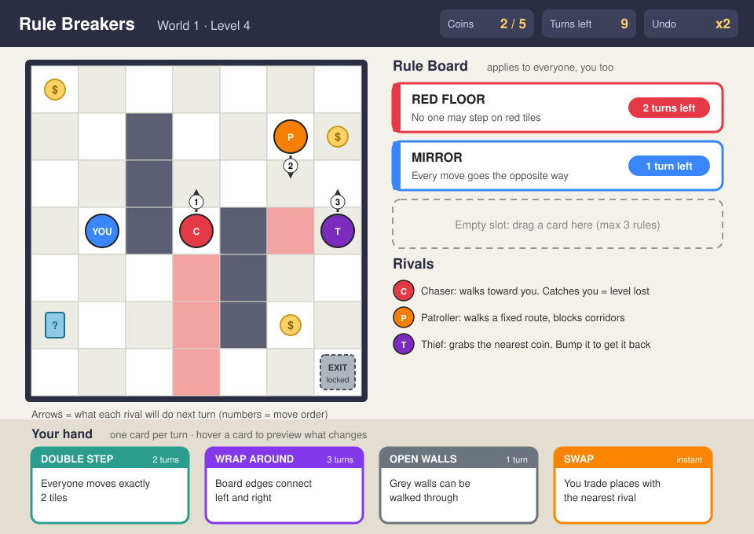

# Rule Breakers

**Every rule you make, you have to follow too.**

## The Concept

Rule Breakers is a turn-based strategy puzzle game. You're on a small grid arena with a few rival characters. To win a level you collect every coin and then reach the exit. You can't fight the rivals, but you can change the rules of the arena by playing rule cards. The catch is that every rule you turn on applies to everyone on the board, you included.

**Platform:** PC and web browser (built in Unity, exported to WebGL so it runs on itch.io). The board is small and turn-based, so a touch version for phones is a natural next step.

*Concept sketch of a level in World 1. The rule board on the right shows two active rules, and the arrows show what each rival will do on its next move.*

---

## Formal Elements

### 1. Players

* **Who it's for:** ages 10 and up. You don't need any gaming experience, because the first world teaches everything. It's aimed at people who like short puzzles and "one more level" games, and at fans of grid strategy games like Into the Breach or chess puzzles. Experienced players get their challenge from the later worlds, where several rules are active at once.
* **How many players:** one player against computer-controlled rivals. A two-player hot-seat mode, where both players hold rule cards, is a possible extra once the main game works.
* **Interaction pattern:** player vs. game. The rivals are competitive opponents, but they're bots with fixed, readable behavior, so every level is really a puzzle against the system.

### 2. Objectives

* **To win a level:** collect every coin on the board, which opens the exit, and then step onto the exit tile before you run out of turns and before the Chaser catches you.
* **Bonus objective:** each level gives up to 3 stars. You get one for finishing, one for finishing within the "par" number of turns, and one for finishing with at least one card left in your hand. Stars unlock the next world.
* **How the game tells you:** every level opens with a one-line goal card ("Collect 5 coins, then escape. Par: 12 turns"). The HUD always shows coins collected out of the total. The exit is drawn as a locked, greyed-out gate, and when the last coin is collected it lights up and plays a sound so you know where to go.

### 3. Procedures

#### The first 30 seconds

There's no menu or story screen in the way. Pressing Play loads Level 1 right away: a 5x5 board, 3 coins, one Chaser, and a single card in your hand.

* **0–10 s:** a ghost hand shows you how to move: click a tile next to your piece (or press the arrow keys). You grab the first coin in two moves.
* **10–20 s:** the Chaser starts heading toward you, and you can see its next move as an arrow. It's standing between you and the last coin. The card in your hand, RED FLOOR ("no one may step on red tiles"), starts glowing.
* **20–30 s:** you drag the card onto the Rule Board, and the board flashes. The Chaser is standing behind a strip of red tiles, so now it's stuck. But you notice the last coin is also behind red tiles, so you walk the long way around and get there just as the rule runs out.

That's the hook: in half a minute you've used the one idea the whole game is built on, and you've seen that it cuts both ways.

#### Core loop

Each turn follows the same order:

1. **Read the board.** Each rival shows an arrow for its next move, and a small number for the order they'll move in.
2. **Play a card (optional).** Drag one card from your hand onto a free Rule Board slot, or press keys 1–4 and then Enter. While you hover over a card, the board previews what changes: the rivals' arrows redraw and your reachable tiles update.
3. **Move.** Click a highlighted tile, or use the arrow keys / WASD. By default you move one tile, but active rules can change that.
4. **Rivals move**, following the same active rules.
5. **The turn resolves.** Coins get picked up, the "turns left" counter drops by one, and every active rule loses one turn. A rule at 0 disappears.

You can press **Z** to undo your last turn, but each level only gives you 2 undos. **Space** ends your turn without moving.

#### Ending

When the last coin is collected, the exit gate opens. You still have to physically get there, and the rules don't stop applying on the way. This is where a lot of levels get their final twist: the rule you used to trap the Chaser now stands between you and the door. Step on the exit and you get a short win animation, a star count, and a "Next level" button. Finishing the last level of World 5 ends the campaign.

#### How the player learns the procedures

World 1 (8 levels) is the tutorial, but it never shows a wall of text. Each level adds exactly one new thing: a new card, a new rival, or a new tile type. A one-line tooltip appears the first time you see it. The hover preview is the main teacher, because you can see what a card will do before you commit to it.

### 4. Rules

#### Rules that limit what you can do

* **The core rule:** every active rule affects every character on the board, you included. There are no exceptions.
* You can play at most **one card per turn**.
* The Rule Board has **3 slots**. If you play a fourth card, the oldest rule is pushed off.
* If two rules conflict, the newer one wins. For example, DOUBLE STEP overrides the basic "move one tile".
* You move up, down, left or right. You can't move through walls or off the board, and you can't end a move on a tile where a rival is standing (except the Thief, see below).
* Each level has a **turn limit**.

#### Rules that decide what happens

* Rivals behave in a fixed way:
  * The **Chaser** always takes the shortest path toward you.
  * The **Patroller** walks a fixed route back and forth.
  * The **Thief** heads for the nearest coin.
* **Move order:** you move first, then the rivals in the numbered order shown on the board.
* **Coins:** a coin is collected when a character ends its move on it. If the Thief takes a coin, it carries it. Walk into the Thief and the coin drops back onto its tile.
* **Losing a level:** if the Chaser ends its move on your tile, you're caught. If you run out of turns, the level is lost. In both cases you restart instantly, with no penalty.
* **No randomness in the campaign:** rival moves are deterministic, and the cards in your hand are hand-picked for each level. The same moves always give the same result.

#### Example cards

| Card | Effect | Lasts |
|---|---|---|
| RED FLOOR | No one may step on red tiles | 3 turns |
| DOUBLE STEP | Everyone moves exactly 2 tiles in a straight line | 2 turns |
| MIRROR | Every move goes the opposite way: you press left, you go right. Rivals are flipped too | 2 turns |
| OPEN WALLS | Grey walls can be walked through | 1 turn |
| WRAP AROUND | The left and right edges of the board connect | 3 turns |
| SWAP | You trade places with the nearest rival | instant |

**Example puzzle (Level 2-3):** you've collected every coin, the exit is open on the far side of the room, and the Chaser is one tile away from you. If you play MIRROR, the Chaser's "step toward you" turns into "step away from you", so it backs off. But your own controls are flipped too. To walk toward the exit you have to press the opposite direction, and you only have 2 turns before the rule runs out and the Chaser comes back at you.

#### How the player learns the rules

The Rule Board is always on screen and shows every active rule in plain words, with a countdown. Each card shows its effect and how long it lasts. The hover preview shows you the result of a rule before you play it. If you get caught, a short replay shows the last two turns so you can see exactly what went wrong.

### 5. Resources

| Resource | What it does for you | How you get it | Why it's scarce |
|---|---|---|---|
| **Rule cards** | Your only way to affect the rivals | Your starting hand, plus card tiles (?) on the board | Each card works once. Levels give 2–5 cards, and card tiles are usually placed near danger |
| **Turns** | Time to finish the level | Fixed number per level | Set just above the par for a good solution, so wasted turns hurt |
| **Rule Board slots** | How many rules can be active at once | Always 3 | A fourth rule pushes the oldest one off |
| **Undos** | Take back a mistake | 2 per level | Doesn't refill within a level |
| **Coins** | Open the exit | On the board | The Thief competes with you for them |
| **Stars** | Unlock new worlds and new card types | 1–3 per level | The third star asks for an efficient solution |

**How the game shows them:** the top bar shows coins (2 / 5), turns left and undos. Your hand sits along the bottom of the screen, and the Rule Board on the right shows active rules with their timers. The world map shows your stars per level.

### 6. Conflicts

* **Player vs. system (obstacles):** walls, red and blue tiles, the turn limit, and the locked exit. Later levels add hands where every card hurts you about as much as it hurts the rivals.
* **Player vs. other players (opponents):** the three rival types. The Chaser can end your level, the Patroller blocks corridors, and the Thief steals coins. In the optional hot-seat mode, the other player becomes your opponent, and they play rules against you too.
* **Player vs. self (dilemmas):** this is where the game lives.
  * Play the card now, or save it for a worse moment?
  * The rule that blocks the Chaser also blocks your shortcut. Is it worth it?
  * Do you grab the coin next to the Chaser now, or come back later when it's somewhere else?
  * Do you spend an undo now, or keep it for the final stretch?

### 7. Boundaries

* **Closed or open?** Closed. Each level is a bounded grid between 5x5 and 9x9, surrounded by a wall. The campaign is a world map of levels you unlock in order, with a few optional branches.
* **Round or flat?** Flat. The edges are hard walls. The one exception is the WRAP AROUND card, which makes the board round for a few turns: walk off the right edge and you come back on the left. Rivals do too, and that's the whole trick of the card.
* **How the boundaries are shown:** a thick dark frame surrounds the board, and nothing outside it can be interacted with. When WRAP AROUND is active, the frame on the connected edges turns into a glowing portal strip.

**How the map follows the design principles:**

* **Meaning:** every tile has a job. Red and blue tiles exist only because some card refers to them, so there's no decorative clutter to misread.
* **Mobility:** movement is one tile in four directions, and boards are small enough to cross in 4–6 turns. Getting around is never the hard part. Getting around safely is.
* **Orientation:** the whole board fits on one screen, with no scrolling and no fog. The exit is always visible, and so is every rival's next move.
* **Interest:** each level introduces one new card, rival or tile. Later levels combine them, and optional star coins sit in risky spots.
* **Guidance:** coins and the open exit glow. Early levels are shaped so that the obvious path is blocked, which pushes you toward the card that solves it.

### 8. Outcomes

* **Possible outcomes:**
  * **Per level:** win with 1, 2 or 3 stars, or lose (caught or out of turns), followed by an instant retry.
  * **For the whole game:** finishing the 5-world campaign. Collecting all stars is an extra goal for completionists.
* **Luck vs. skill:** almost all skill. Rivals are deterministic and show their moves in advance, and campaign hands are fixed, so losing is always your own misplay. Luck only appears in an optional endless mode, where cards are drawn at random.
* **Zero-sum, cooperative or complex?** Inside a level it's zero-sum: either you escape or the rivals stop you. The hot-seat mode is zero-sum between two players. There's no cooperative mode.

---

## Market Survey

**Search terms used:** "puzzle game where you change the rules of the level", "Fluxx digital game changing rules Steam", "Into the Breach enemies telegraph attacks grid".

### 1. Baba Is You

https://store.steampowered.com/app/736260/Baba_Is_You/

<!-- Add a screenshot here before submitting, e.g.  -->

The closest match to our idea, and an award-winning one. Each level's rules are written as word blocks on the board ("WALL IS STOP", "FLAG IS WIN"), and you push the words around to change how the level works.

**How we're different:** Baba Is You has no opponents, and its rules are sentences you rebuild. In Rule Breakers, rules are cards that rivals react to, and the core twist is different: every rule hits you as hard as it hits them. Baba is also known for getting very hard very fast. We're aiming at a younger, more casual audience, with a gentler curve and a hover preview that shows you what a rule will do before you play it.

### 2. Fluxx (card game and digital app)

https://www.looneylabs.com/fluxx

<!-- Add a screenshot here before submitting -->

A card game, also released as a digital app, where players change the rules and even the winning goal by playing cards during the game.

**How we're different:** Fluxx has no board and no movement, and it depends heavily on which cards you happen to draw. Rule Breakers puts the rule-changing idea onto a spatial grid. It's deterministic, so a good plan always works, and it's built for one player who wants to solve a puzzle, not a group that wants chaos.

### 3. Into the Breach

https://store.steampowered.com/app/590380/Into_the_Breach/

<!-- Add a screenshot here before submitting -->

A turn-based strategy game on a small 8x8 grid, where enemies show their attacks a turn ahead and you shove them around to make them miss.

**How we're different:** Into the Breach has the same "read the enemy's next move and plan around it" feel, but its rules never change and you fight with weapons. Rule Breakers has no combat at all. Your only tool is the rulebook, and every change you make lands on you as well. It's also much smaller and simpler, with short levels that run in a browser.

### Which formal element makes the game unique?

**Rules**, and right after them **conflicts**. Other games let you change the rules (Baba Is You, Fluxx), and others let you read your opponents' moves on a grid (Into the Breach). What none of them do is make the rules symmetrical: every rule you add is a weapon against the rivals and an obstacle for you at the same time. That's what creates the main dilemma in every level: is this rule hurting them more than it hurts me?
